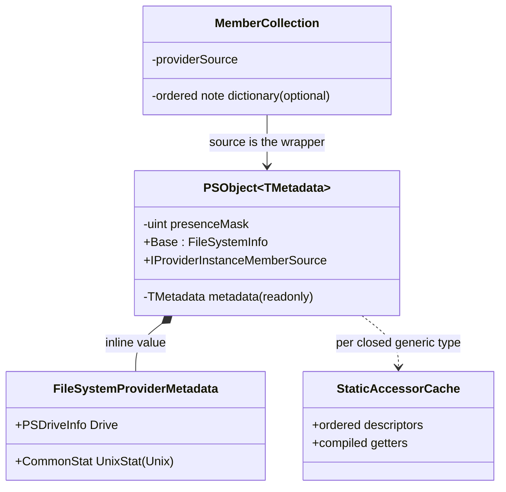
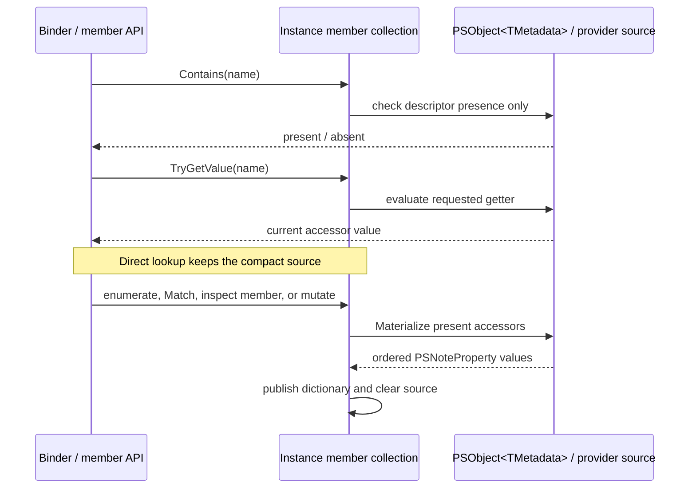
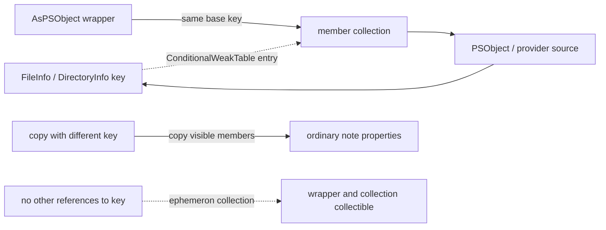

# Provider instance metadata

This note describes the opt-in compact provider-member path for engine developers. The
implementation is centered in `engine/ProviderPSObject.cs`, `engine/MshObject.cs`,
`engine/MshMemberInfo.cs`, and `namespaces/ProviderBase.cs`.

## Shape and lifetime

With the `PSOptimizedProviderObjects` experimental feature enabled, the built-in
FileSystem provider can wrap eligible `FileInfo` and `DirectoryInfo` output in
`PSObject<FileSystemProviderMetadata>`. The closed generic wrapper stores a readonly
metadata struct and a presence mask inline. On Unix that struct has both `PSDriveInfo`
and `CommonStat UnixStat`; on other platforms it has the drive. The wrapper also
implements `IProviderInstanceMemberSource`, which describes virtual instance notes
without constructing one `PSNoteProperty` per result.

Accessor methods on the metadata type carry a name, order, and optional presence-mask
bit. The generic type's static initializer reflects over only methods declared on that
metadata type, validates signatures and member names, compiles a getter delegate for
each valid method, sorts the accessors by order, rejects duplicate names
(case-insensitively) and duplicate order values, and registers member names with the
get-member binder. A getter is static and non-generic, returns a non-void,
non-byref, non-pointer, non-byref-like value, and takes a reference-type base argument
(class or interface). It can optionally take a second `in TMetadata` argument. The
base argument is cast from the wrapper's `Base`; the metadata argument is read from
the wrapper. For example, FileSystem accessors use both forms:

```csharp
[PSObjectMetadataAccessor("PSChildName", 2, 2)]
private static string GetChildName(FileSystemInfo file)
    => FileSystemProvider.GetChildNameForMetadata(file.FullName);

[PSObjectMetadataAccessor("PSPath", 0)]
private static string GetPath(FileSystemInfo file, in FileSystemProviderMetadata metadata)
    => LocationGlobber.GetProviderQualifiedPath(file.FullName, metadata.Drive.Provider);
```

`PSObject<TMetadata>` checks names with `OrdinalIgnoreCase`. Accessors whose presence
bit is not set do not participate in lookup, enumeration, or `Count`. An accessor with
no bit is always present. This lets the same descriptor set describe results where
some provider notes were not supplied.



The compact representation avoids a separate metadata carrier and per-result value
array. It still allocates the `PSObject<TMetadata>` wrapper, member collection, and
`ConditionalWeakTable` entry; compiled accessors are shared per closed generic type.

The feature is currently eligible only for FileSystem provider output where the
provider implementation is the built-in `FileSystemProvider`, the item is a
`FileSystemInfo`, a drive is available, the supplied container flag is absent or agrees
with whether the item is a `DirectoryInfo`, and the item has no existing instance
members. Other providers, content output, and ineligible items keep the legacy
`PSNoteProperty` path. In particular, the compact path cannot infer the originating
drive from a `FileInfo`; the drive is carried explicitly in the metadata and its
provider supplies `PSProvider`.

The filesystem accessors intentionally have mixed time semantics. `PSPath`,
`PSParentPath`, and `PSChildName` use the wrapped `FileInfo`/`DirectoryInfo`'s current
`FullName` when read. `PSIsContainer` uses its current runtime type. Consequently,
unmaterialized path values track operations such as `FileInfo.MoveTo`. Paths are
computed on each read (and strings may be allocated); the mechanism does not make
path lookup allocation-free. `UnixStat`, when present, is captured from the provider's
emission path with `LStat`, so it remains an emission-time snapshot. Drive and provider
come from the carried drive value.

## Lookup, promotion, and inspection

The wrapper itself implements `IProviderInstanceMemberSource` and is attached to the
normal `PSMemberInfoInternalCollection` as its provider source.
The binder's instance-member helpers ask the collection to check membership or retrieve
a value. While compact, `Contains` and `TryGetValue` consult the source directly; neither
needs to enumerate or materialize note properties. `Contains` checks only descriptor
presence and does not evaluate a getter; `TryGetValue` evaluates the requested getter.
`TryGetInstanceMember`, used when an actual `PSMemberInfo` object is required, goes
through the member indexer and promotes the source. Thus direct value reads can use
compiled accessors, while APIs that expose member objects retain the established model.

Enumeration, wildcard `Match`, direct member inspection through the indexer, and
mutations that need to preserve existing values promote the source. Promotion creates
ordinary `PSNoteProperty` instances and inserts them in the existing ordered dictionary
using case-insensitive keys, then clears the provider source. While compact and after
promotion, the instance members retain ordinary ETS instance-member precedence over
adapted members. Once promoted, computed values are a snapshot, with ordinary note
property mutation behavior; this also keeps reflection and serialization paths that
inspect members on their established representation. The collection uses
locking and volatile publication for its source/dictionary transitions. This protects
those transitions, but should not be read as a guarantee that arbitrary concurrent
mutation and inspection of all wrapper state is generally thread-safe.



## Resurrection and copying

`PSObject` stores instance members in a `ConditionalWeakTable` resurrection table keyed
by `GetKeyForResurrectionTables`. For this wrapper that key normally resolves to the
base `FileInfo` or `DirectoryInfo`. The table value is the member collection, and while
compact that collection points back to the wrapper, which is also the source. This cycle is intentional:
the ephemeron semantics of `ConditionalWeakTable` allow the key and value cycle to be
collected when the base object is otherwise unreachable. A caller can unwrap the result
through `Base` and later wrap that same base with `AsPSObject`; the same key then
recovers the member collection and wrapper/source. Strings, `PSCustomObject`, and
wrappers with `StoreTypeNameAndInstanceMembersLocally` have special key rules in
`GetKeyForResurrectionTables`. Boxed value types ordinarily use their base-object key,
and copying one creates a new box. When copying produces a different resurrection key
(for example, because the base object is cloned), `PSObject.Copy` re-adds visible
members and type names to the copy, which promotes/copies the source values as ordinary
members.



## Validation entry points

The focused tests cover metadata descriptors, presence, promotion, cached binder reads,
wrapping/resurrection, and filesystem behavior. For an engine build that has already
been produced, useful entry points are:

```powershell
dotnet test test/xUnit/xUnit.tests.csproj --filter FullyQualifiedName~PSObjectTests
```

The PowerShell integration tests are in
`test/powershell/Modules/Microsoft.PowerShell.Management/OptimizedProviderObjects.Tests.ps1`.
Run them with an isolated `pwsh` and a `-SettingsFile` JSON containing
`{"ExperimentalFeatures":["PSOptimizedProviderObjects"]}` to exercise the enabled
path; the test file also covers compatibility behavior with the feature disabled.
The process-isolated benchmark harness is
`test/perf/benchmarks/ProviderMetadata.ProcessBenchmark.ps1`; pass it the built
`pwsh` path with `-PwshPath`. Treat benchmark results as environment-specific evidence,
not as a production performance claim.
