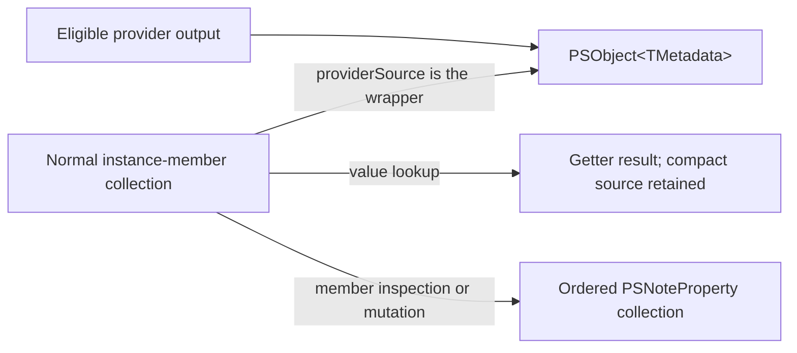
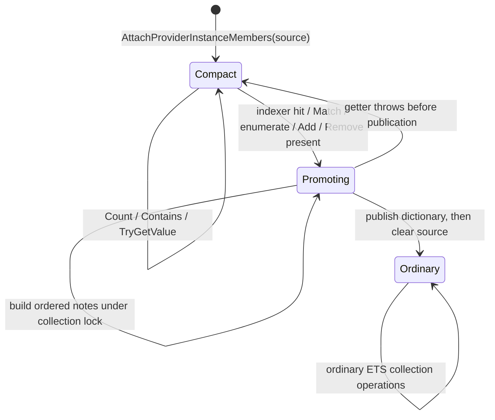
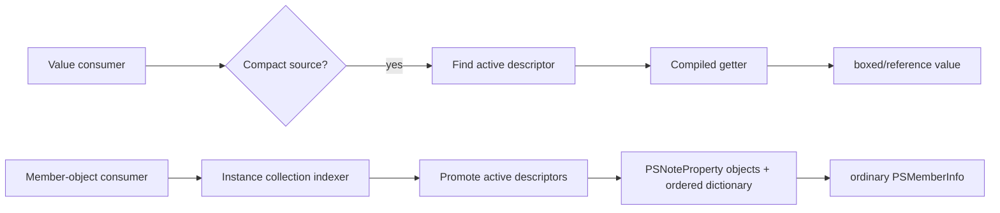
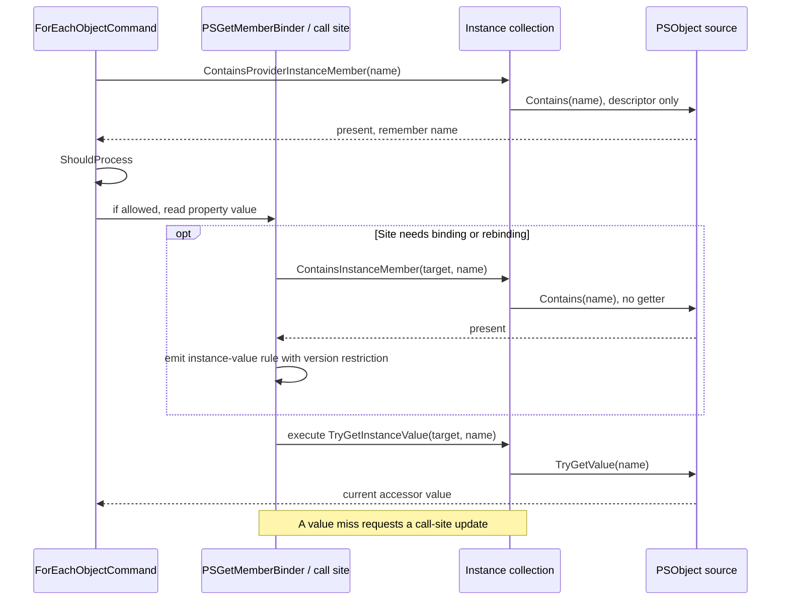
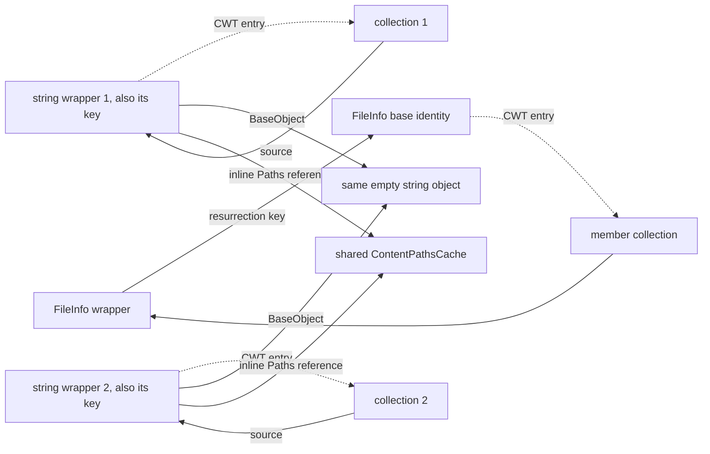

# Provider instance metadata

This guide explains why the experimental provider metadata path is represented and bound
as it is. It is written for engine engineers changing provider output, ETS lookup, copying,
or content emission. The implementation is centered on [`ProviderPSObject.cs`](../../src/System.Management.Automation/engine/ProviderPSObject.cs),
[`MshObject.cs`](../../src/System.Management.Automation/engine/MshObject.cs),
[`MshMemberInfo.cs`](../../src/System.Management.Automation/engine/MshMemberInfo.cs),
and the provider/content producers linked in the source map below.

`PSOptimizedProviderObjects` is an opt-in experimental feature. Eligible producer paths
attach a provider-backed source to the ordinary instance-member collection. That source
represents generated notes with descriptors and getters; it does not replace the PowerShell
member model. Value-oriented lookups may stay compact, while APIs requiring real
`PSMemberInfo` objects promote the source into normal note properties.



The source is the wrapper itself: `PSObject<TMetadata>` implements
`IProviderInstanceMemberSource`. The interface is not a separately allocated per-result
carrier. Its static descriptor array is shared by the closed generic type; its metadata
struct and presence mask belong to each wrapper.

## Why the representation is shaped this way

The optimization targets a particular repeated cost: provider output used to carry ordinary
instance notes, represented by `PSNoteProperty` objects and collection storage, even when a
consumer only reads one known property or never inspects properties at all. A compact
source changes the per-result representation while retaining the normal member collection
as the point of integration. It does not remove the `PSObject` wrapper or promise that
property reads allocate nothing.

A value-type metadata payload is a field on `PSObject<TMetadata>`. This avoids allocating
an object array (or a separate carrier object) for each result. Accessor descriptors and
compiled delegates are static for each closed `TMetadata`; they are not rebuilt for every
file. The collection object and resurrection-table entry still exist, and a wrapper still
exists. A value-returning accessor is converted to `object` by the compiled delegate, so
value types box on that boundary. Accessor computations such as path formatting can also
allocate strings. The design removes eagerly allocated member carriers; it is not an
allocation-free object model.

For a small fixed member set, a linear scan of a shared descriptor array avoids allocating
an index per result. Each successful read invokes the getter again; there is no value cache
in the generic wrapper. That favors emission and lightly read metadata. Repeated reads of
a computed path can allocate more strings than legacy notes, which store one string and
reuse it. Content getters return shared cached path strings instead. Caching every item
getter would add retained per-result storage and would require invalidation for live paths.
The tradeoff must be measured separately for emission, repeated reads, and inspection.

For FileSystem items, the descriptors are an explicit contract. Their order is
`PSPath` (0), `PSParentPath` (1, mask 1), `PSChildName` (2, mask 2), `UnixStat` (3,
Unix only, mask 4), `PSDrive` (4, mask 8), `PSProvider` (5), and `PSIsContainer` (6,
mask 16). Unmasked entries are always present. A mask value of 3 would require both bits 1
and 2; it does not mean “either bit.” The masks encode optional parent, child, stat, drive,
and container properties.

An accessor declaration shows both data sources: the base object is supplied as the first
parameter and the inline metadata as an optional readonly second parameter.

```csharp
[PSObjectMetadataAccessor("PSPath", 0)]
private static string GetPath(FileSystemInfo file, in FileSystemProviderMetadata metadata)
    => LocationGlobber.GetProviderQualifiedPath(file.FullName, metadata.Drive.Provider);
```

The descriptor contract is deliberately fixed when a closed generic type initializes:

| Contract item | Rule and reason |
| --- | --- |
| Name | Non-empty, non-reserved, unique under `OrdinalIgnoreCase`, matching PowerShell member lookup semantics. |
| Order | Non-negative and unique. Sorting once provides stable member enumeration order. |
| Presence mask | Zero means always present. A nonzero value is an all-bits-required mask: every requested bit must be set. This supports optional groups without per-instance descriptor lists. |
| Method | Static, non-generic; avoids retaining a target object or doing reflection dispatch on every read. |
| First parameter | Class or interface reference type, not byref/pointer. It describes the base accepted by the accessor and makes the wrapper's base cast explicit. |
| Optional second parameter | Exactly `in TMetadata`. It passes the inline struct by readonly reference and allows metadata access without boxing/copying through an object carrier. |
| Return type | Not void, byref, pointer, or byref-like, because the public member value boundary is `object`. |

Invalid declarations throw during descriptor creation. The empty explicit static
constructor on `PSObject<TMetadata>` is also intentional: it suppresses the CLR's
`beforefieldinit` relaxation for this type. Its purpose is ordering, not state setup. The
static accessor array must be created, validated, and registered with the binder before a
wrapper can be observed and a dynamic get-member rule can be selected. Without that
ordering guarantee, binder call sites could decide there are no relevant instance members
and cache an unsuitable path before descriptor registration.

The accessor factory registers names with `PSGetMemberBinder.SetHasInstanceMember` only
after all descriptors have been validated. Registration is a conservative global hint:
for that name, binder rules must consider instance members. It does not say that every
object has that member; each wrapper's active mask and instance collection still answer
whether it is present. Registration occurs for the full descriptor set, including
conditionally present properties, so a missing optional member may take a slower check.
This is necessary for correctness when different instances of one generic type have
different masks.

## Binding paths and lookup distinctions

The dynamic value path is emitted by `PSGetMemberBinder.FallbackGetMember`. At bind
time, `_hasInstanceMember` is a conservative per-name hint. When it is set, the binder
calls `ContainsInstanceMember` on the current target to select an instance-value rule.
That presence check does not evaluate a getter.

The emitted rule has a binder-version restriction and calls `TryGetInstanceValue` at
execution time. A successful hot read does not repeat the binding-time `Contains` call:
the value helper both finds the member and reads its value. If it returns false, the rule
requests a call-site update so binding can select the appropriate fallback. It caches
neither the computed value nor the source wrapper, allowing the same rule to read lazy
and materialized instance members on subsequent targets.

Negative/adapted rules for a registered name use absence checks in their restrictions.
Registering a previously unknown instance-member name increments binder versions and
invalidates older rules that could otherwise bypass instance lookup. `Contains` must
therefore remain a presence-only operation, including when it runs in a restriction.

An explicit member-object caller instead uses `TryGetInstanceMember`. A hit goes through
the collection indexer and promotes the source. This helper is distinct from the
`TryGetInstanceValue` call emitted for ordinary dynamic property reads.

`PSGetMemberBinder.SetHasInstanceMember` updates name-based dynamic member lookup call sites.
A member object and a member value are observably different requests. `PSMemberInfo` exposes
identity, type, and mutation operations that a computed getter cannot represent by itself;
value lookup only needs the current value. The engine preserves the former API by promoting,
and uses the direct getter for the latter.

`TryGetInstanceValue` checks only instance values; it does not query adapters or synthesize
special members. In particular, `ToString` has special behavior in member binding and
`FullName` is an adapted .NET property of `FileInfo`; neither is a provider instance note.
The provider value source's `Contains` means “this descriptor is present on this object,”
not “some way of invoking a similarly named member exists.” If the instance check misses,
the binder proceeds to its separate adapted/special-member logic according to established
rules.

This distinction also explains why an unsuccessful direct instance lookup should remain
unsuccessful even if the base object's adapter can resolve a name. Falling through to an
adapter is a separate binder stage, with its own semantics. Collapsing these stages would
make cached provider metadata shadow, or pretend to be, a .NET member.

## Collection state machine

The instance collection has two storage modes: a lazy provider source and an ordered
ordinary-member dictionary. Promotion is one-way for that collection. The table below
summarizes the intent; exact public APIs may wrap these primitives with additional PowerShell
semantics.

| Operation | Compact source behavior | Reason / resulting state |
| --- | --- | --- |
| Internal instance collection `Count` / `VisibleCount` | Count active descriptors without evaluating them. | Shape inspection need not allocate note objects or invoke potentially expensive getters. The public integrated `PSObject.Properties.Count` may enumerate the combined view and materialize. |
| `Contains(name)` | Compare case-insensitively against active descriptor names; no getter call. | Presence checks should not compute values. |
| Value lookup (`TryGetValue`) | Invoke only the named getter; stay compact. | This is the hot path when a caller consumes a known value. |
| Indexer (`this[name]`) hit | Promote, then return the dictionary member. | Caller asked for a member object with normal identity/mutation semantics. |
| Indexer (`this[name]`) miss | Return missing without promotion. | A failed probe should not force all values into note objects. |
| `Match` / wildcard matching | Promote and use normal `PSMemberInfo` matching. | Matching returns member objects and must include the usual collection behavior. |
| Enumeration / copy to list | Promote, then enumerate dictionary values. | Enumerators expose `PSMemberInfo` objects, not just values. |
| Add a custom member | Promote before inserting. | Existing provider values must coexist in normal ordered storage with normal duplicate-name rules. |
| Remove a present name | Promote first, then remove from ordinary storage. | Removal semantics apply to actual collection entries. A removed generated note must not reappear from the source. |
| Remove an absent name | Return without promotion. | There is no generated member to suppress or ordinary entry to remove. |
| Copy requiring a different key | Copy visible members onto the destination. | The new object's identity needs its own member collection; ordinary notes preserve the source values. |
| Serialization / member inspection | Use normal members, which promotes as those APIs enumerate or index. | Existing serializers and inspectors already understand `PSMemberInfo` collections. |

`Count` does not imply that all getters are safe to invoke, so active descriptor counting is
separate from materialization. Likewise `Contains` is intentionally cheaper and less
observable than value lookup. Keep this distinction when adding APIs: if the API promises a
`PSMemberInfo`, materialize; if it only needs a value, first consider the source's direct
value method.

Promotion builds an `OrderedDictionary` with `StringComparer.OrdinalIgnoreCase`, inserts
all currently present properties in declared order, and then clears the source reference.
This drops the collection's source reference; it does not clear the readonly `_metadata`
field on the wrapper. An extant wrapper can therefore still retain its metadata/cache after
promotion.
The source is cleared only after the dictionary has been populated. Creation is performed
under the collection's lock, and the source/dictionary references use volatile publication
where readers check state without taking that lock. If an accessor throws while building
the temporary dictionary, publication has not happened: the original provider source stays
available and the failing operation throws. Already-created temporary note objects are not
published. This gives the operation a coherent retryable source state, not a guarantee that
arbitrary concurrent reads and writes on every `PSObject` member API are thread-safe.

Whole-source promotion keeps one coherent representation for APIs that expose mutable
member objects. A hybrid overlay would need rules for ordering generated and user-added
members, resolving duplicate names, representing removals of still-generated descriptors,
and ensuring repeated inspection returns stable `PSMemberInfo` identity. Tombstones or a
second overlay dictionary would recreate much of the bookkeeping this representation
avoids. Promotion snapshots every currently present getter value once, then established
collection behavior handles replacement, removal, enumeration, and identity. Values become
snapshots after promotion even when their compact getter had been live before inspection.



## Value lookup versus collection inspection

A failed member-object probe is also important. `PSObject.ToString` checks the instance
collection for a custom `ToString` method. `ForEach-Object` builds a target description
through that conversion even when its requested member is `FullName`. Neither `ToString`
nor `FullName` belongs to the provider descriptor set. If a missing indexer lookup promoted
unconditionally, this apparently ordinary CLR-property pipeline would allocate all provider
notes. The indexer checks source membership before promotion and rereads published dictionary
state, allowing an absent provider name to fall through without evaluating any accessor.

A direct accessor call has this conceptual shape:

```text
name -> descriptor index -> active-mask check -> cached delegate(wrapper)
      -> cast wrapper.Base -> static accessor(base, in wrapper.metadata) -> object value
```

The descriptor search is over the small, stable descriptor array. The delegate is compiled
once per metadata type, so there is no per-read reflection invocation. The cast and call
still execute, and converting a struct result to `object` boxes it. In addition, accessors
can call path helpers or return reference objects. Whether a specific lookup allocates
therefore depends on its return type and work; the implementation makes no blanket
allocation claim.

Member inspection follows a different path:



That boundary is purposeful. It lets the engine preserve mature APIs and semantics for
inspection, wildcard matching, member mutation, and serializers without requiring all those
subsystems to learn a new kind of `PSMemberInfo`.

`ForEach-Object -MemberName PSPath` has a specific lazy path. `ForEachObjectCommand` first
calls `ContainsProviderInstanceMember` to recognize an exact provider-backed property
without materializing it. It records the provider property name, calls `ShouldProcess`,
then invokes the ordinary dynamic property getter only if processing is allowed. This
ordering preserves `-WhatIf` behavior and getter error handling, and only then evaluates
the requested accessor. This exact-name path is different from wildcard operations such
as `$item.PSObject.Properties.Match('PS*')` or `ForEach-Object -MemberName 'PS*'`; wildcard
resolution returns member objects and uses `Match`, which promotes. Enumerating the
properties collection also promotes. A script block that
does `$_.PSPath` also uses dynamic get-member semantics; the binder's value branch can read
directly, while explicit property-object inspection materializes. The API's requested
result shape determines whether promotion is required.



The ForEach preflight lets the cmdlet distinguish a provider-backed exact name from an
ordinary member without creating a `PSMemberInfo`. Separately, the dynamic rule's
restriction lets the binder distinguish registered names absent on a particular wrapper.
Neither check calls a getter. The value call retrieves the property only when the rule
applies. If no instance value is found, the dynamic rule updates and the binder tries
the ordinary adapted or special-member path. This keeps `FileInfo.FullName` available as an
adapted .NET property without making it look like a provider note, and keeps special
`ToString` behavior outside this provider source.

There is a separate notification when the source is attached. The accessor factory calls
`PSGetMemberBinder.SetHasInstanceMember(name)` to update name-based dynamic member rules.
`PSObject.AttachProviderInstanceMembers` also calls
`PSVariableAssignmentBinder.NoteTypeHasInstanceMemberOrTypeName(baseType)`. The latter
immediately returns for reference types and immutable value types; that includes the
current FileInfo, DirectoryInfo, string, and scalar-byte producers. It preserves assignment rule
correctness if a future producer uses a mutable boxed value type. This type notification is
not a claim that FileInfo needs type invalidation.

## Built-in provider eligibility and temporal behavior

The FileSystem provider's item optimization is gated in `ProviderBase.WrapOutputInPSObject` and is
limited to the built-in FileSystem provider and `FileSystemInfo` items. The provider also
requires a usable drive, compatible container state, and no preexisting instance members.
The last condition matters because wrapping with the compact source must not discard
provider- or caller-supplied notes. Other providers and ineligible item types follow the
legacy note attachment path.

The `FileInfo`/`DirectoryInfo` object does not retain the PowerShell drive through which it
was discovered. `PSDrive` and `PSProvider` therefore come from carried metadata, rather than
being guessed from `FullName` later. Unix `CommonStat` is likewise attached at emission time:
re-running `LStat` on each property access would change the meaning and cost of the existing
snapshot. The path-like properties deliberately use a mixed policy: current `FullName` and
runtime type determine `PSPath`, parent, child, and container status, while drive/provider
identity and Unix stat are carried values. A move can consequently change the computed path
properties while leaving Unix stat and drive identity as captured references/values.
This live-path behavior intentionally differs from the legacy emission-time path snapshot
and is covered by feature-on/off tests. It is not a transparent representation-only change.
A captured `PSDriveInfo` or `ProviderInfo` reference does not make those objects immutable.

Content results have different requirements. `Get-Content` resolves a path through provider
and drive context; a string has no filesystem identity from which to recover the original
PowerShell path. `ContentPathsCache` retains that resolved context once per path. Per-output
`ContentOutputMetadata` stores a `long ReadCount` and a reference to the shared cache. This
avoids repeating path-note objects while preserving the path snapshot and independently
varying `ReadCount` for each output. `FileInfo` alone would not represent the command's
resolved PowerShell path or preserve custom-drive syntax and identity.

The content optimization is deliberately restricted to unwrapped scalar string and byte outputs
from the built-in FileSystem provider, with no existing instance members. It covers individual
lines/bytes and `-Raw` strings. `-Raw -AsByteStream` produces one `byte[]`, and batched
`IList` output remains on the legacy note-property path. Strings and bytes are wrapped
individually. For strings, `GetKeyForResurrectionTables` uses the wrapper identity, not string
value equality. For bytes, it uses the boxed byte object's reference identity; distinct boxes
with the same numeric value keep separate metadata, while unwrapping and rewrapping the same
box recovers that metadata. Each output wrapper therefore owns its own metadata, including
repeated empty strings or equal byte values. For a `FileInfo` wrapper, the key
ordinarily resolves to the `FileInfo` base identity, so wrappers around the same FileInfo
intentionally recover the same collection.

`IList` batch objects, byte arrays, and other content types retain the existing
materialized-note behavior.
The development evidence included an observed stall in a nested-batch test when
broader content wrapping was tried (`Get-Content -ReadCount 2 -Tail 3` in the existing
Get-Content suite). The root cause was not established. Broader eligibility remains
unproven until that behavior is understood and covered by focused tests.

## Copying, identity, and lifetime

The instance-member resurrection table is a `ConditionalWeakTable` keyed by
`GetKeyForResurrectionTables`. That method deliberately normalizes wrapper cases: ordinary
PSObject wrappers generally share the base-object key, while strings, `PSCustomObject`, and
wrappers marked to store members locally use their special key policy. For a FileInfo
wrapper, unwrapping and rewrapping the same `FileInfo` can recover the same instance-member
collection. For content strings, each wrapper object is a separate key even when wrappers
hold equal text or the same shared base string reference. The string is not the CWT key.

The collection-to-source-to-wrapper-to-base cycle does not by itself leak the base: the
conditional weak table's ephemeron semantics allow the key/value cycle to be collected when
the key is otherwise unreachable. This is why the table can preserve members across a
wrapper reconstruction without requiring a strong global dictionary that permanently
retains all provider results.



`PSObject.Copy` checks whether source and result have the same resurrection key. When the key
is shared, the existing collection is naturally reused according to the table policy. When
copying creates a different key, the copy path re-adds the visible instance members and
type names to the new object. For compact provider metadata, obtaining that visible member
set promotes it and carries the generated values as normal notes. The destination therefore
has independent ordinary member state and does not retain a compact source whose fields
belong to the original wrapper. Review copy changes against both cases: same key and
changed key.

## Feature boundary and extension checklist

`PSOptimizedProviderObjects` is an experimental feature gate. Keep all producer-side
eligibility checks behind that gate and retain the existing fallback. The feature being off
must continue to produce the legacy object/member shape. A new metadata type also needs its
static descriptors to be valid before the first instance escapes.

When extending this mechanism, review these invariants:

1. Accessor names and order are stable, reserved names are rejected, and names/orders are unique.
2. Every optional descriptor uses the intended all-bits-required mask; `0` remains always present.
3. Getter parameters exactly match the supported static signature; metadata is `in TMetadata`.
4. Descriptor initialization completes before a binder can cache a rule for its names.
5. The get-member binder is notified of every descriptor name, including names absent on some instances; attachment also invokes the variable-assignment type notification.
6. Value lookup checks presence without promotion; member-object lookup and inspection materialize.
7. Instance members keep their precedence over adapted members, while adapters remain a separate fallback stage.
8. Promotion publishes only a complete ordered dictionary, and failures leave the source reachable.
9. Custom existing notes prevent compact wrapping; no path silently drops externally supplied members.
10. Snapshot versus live data is explicit for every field; do not recompute data whose old semantics were captured.
11. CWT identity is reviewed for base-object keys, strings, local-member wrappers, and copies with a new key.
12. Feature-off and ineligible objects keep the legacy code path.
13. Tests cover direct value reads, missing optional names, promotion, mutation/removal, enumeration, copy, serialization, and repeated equal strings where relevant.
14. Benchmarks compare equivalent outputs and report runtime/build/environment; do not infer production guarantees from one harness run.

A code review should ask not just “does lookup work?” but “which APIs force a real member
object, what is the temporal meaning of each value, and which identity owns the attached
state?” Those questions catch most integration regressions in this design.

## Source map

| Concern | Implementation |
| --- | --- |
| Generic wrapper, attribute contract, descriptor validation/compilation, FileSystem metadata accessors | [`ProviderPSObject.cs`](../../src/System.Management.Automation/engine/ProviderPSObject.cs) |
| PSObject wrapping, member attachment, resurrection keys, copying | [`MshObject.cs`](../../src/System.Management.Automation/engine/MshObject.cs) |
| Lazy source, promotion, lookup, enumeration and mutation behavior | [`MshMemberInfo.cs`](../../src/System.Management.Automation/engine/MshMemberInfo.cs) |
| Dynamic get-member and value/member lookup binders | [`Binders.cs`](../../src/System.Management.Automation/engine/runtime/Binding/Binders.cs) |
| FileSystem eligibility, wrapper construction, and emission-time Unix `LStat` capture | [`ProviderBase.cs`](../../src/System.Management.Automation/namespaces/ProviderBase.cs) |
| Content metadata, emission path, path cache, legacy note fallback | [`ContentCommandBase.cs`](../../src/Microsoft.PowerShell.Commands.Management/commands/management/ContentCommandBase.cs) |
| Built-in FileSystem provider lexical path helpers | [`FileSystemProvider.cs`](../../src/System.Management.Automation/namespaces/FileSystemProvider.cs) |
| Focused engine tests | [`test_PSObject.cs`](../../test/xUnit/csharp/test_PSObject.cs) |
| PowerShell integration tests | [`OptimizedProviderObjects.Tests.ps1`](../../test/powershell/Modules/Microsoft.PowerShell.Management/OptimizedProviderObjects.Tests.ps1) |
| `ForEach-Object -MemberName` provider preflight, `ShouldProcess`, then dynamic getter | [`InternalCommands.cs`](../../src/System.Management.Automation/engine/InternalCommands.cs) |
| Process benchmark driver | [`ProviderMetadata.ProcessBenchmark.ps1`](../../test/perf/benchmarks/ProviderMetadata.ProcessBenchmark.ps1) |

## Validation and benchmark workflow

The commands below assume the engine binaries already exist and are in the expected
repository build layout. The exact runtime and test project may vary by checkout; use the
repository's normal build/test instructions when these paths do not match.

```powershell
# Feature-specific tests are SkippableFacts. The filter alone does not enable the feature:
# put a test-host powershell.config.json beside the test assembly before running them, with
# ExperimentalFeatures containing PSOptimizedProviderObjects.
dotnet test test/xUnit/xUnit.tests.csproj --filter FullyQualifiedName~PSObjectTests

# Integration suite: use the repository test runner and an isolated pwsh configured with
# {"ExperimentalFeatures":["PSOptimizedProviderObjects"]}.
# The test script also includes feature-disabled compatibility checks.

# Benchmark harness: pass the exact built executable under test.
./test/perf/benchmarks/ProviderMetadata.ProcessBenchmark.ps1 -PwshPath <path-to-pwsh>
```

The harness runs the baseline with the feature disabled and the candidate with it enabled.
For example, pass the candidate executable through `-PwshPath` and the baseline executable
through `-BaselinePwshPath`:

```powershell
./test/perf/benchmarks/ProviderMetadata.ProcessBenchmark.ps1 `
    -BaselinePwshPath <baseline-pwsh> -PwshPath <candidate-pwsh>
```

Benchmarks are evidence about those builds and that machine. Keep command shape, input
count, output use, and runtime comparable. The harness separates processes to reduce
cross-run state contamination, but process isolation does not control
thermal state, filesystem cache, GC policy, or unrelated load. Report distributions and
raw output when making a performance claim.

A stale-publish trap is especially easy to hit in this work: changing source and launching
an already-existing `pwsh` measures the old binary. Before collecting results, verify the
binary's build timestamp or build identifier matches the source revision under test, and
use both paths passed to `-BaselinePwshPath` and `-PwshPath` explicitly. Rebuild after
source changes and do not compare one new binary with one stale one.
