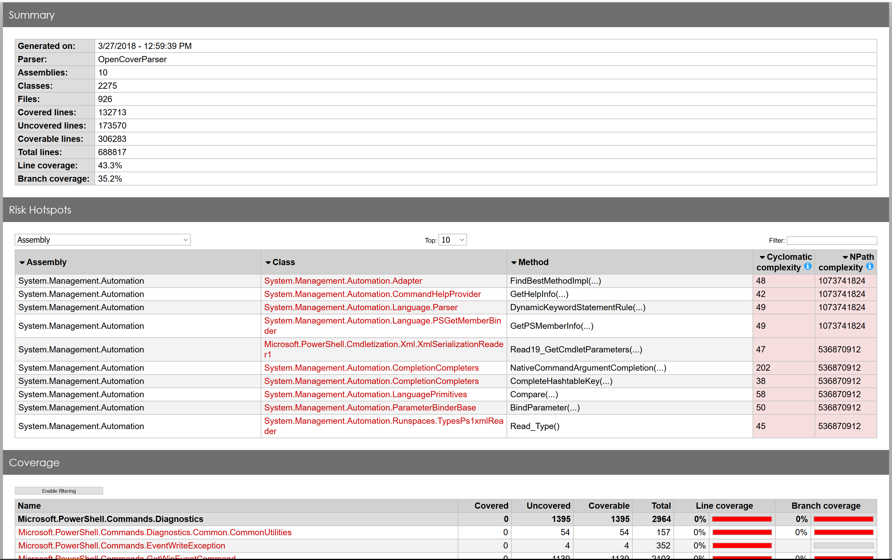
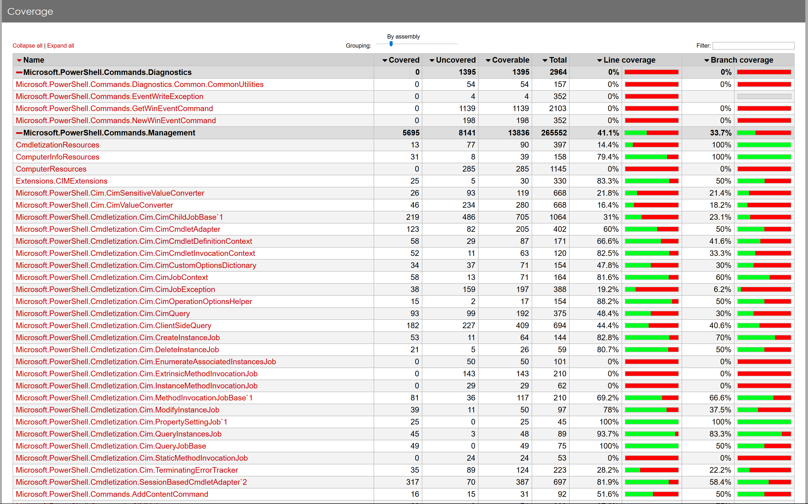

# Getting Code Coverage Analysis for PowerShell

## Pull request CI coverage

GitHub Actions `PR-CI` runs the existing Pester CI/Others, elevated/unelevated
(including experimental-feature runs), and xUnit suites once per platform on
Windows, Linux, and macOS, using native x64 and Arm64 runners.
Coverage is collected during that single test pass for every PR, including PRs
without C# or PowerShell changes, so current total coverage is always reported.
PowerShell-only changes collect **C# execution coverage**, not PowerShell
statement coverage.

`tools/codecoverage.psm1` uses pinned `dotnet-coverage` static instrumentation;
this supports Arm64 on Linux and macOS and includes instrumented subprocesses.
Coverage builds retain symbols. xUnit dependencies are built before instrumentation
and tests use `--no-build` so instrumented binaries are not overwritten.
Collection/reporting functions live in this module; no external coverage service
or write-enabled PR token is required.
During collection, `PS_CODE_COVERAGE=1` lets the startup assembly check account
for the static tracker's two additional dependencies without relaxing normal builds.
On Unix, collection creates separate, private runtime directories for the runner
and sudo processes. Elevated tests and their collector receive explicit
`XDG_RUNTIME_DIR` and `TMPDIR` sudo overrides, avoiding .NET mutex ownership
conflicts with the runner and older runtimes without changing existing permissions.
Directory names are kept short to accommodate Unix-domain socket path limits.
The temporary directories are removed after collection. Collector diagnostic logs
are included in the coverage artifact; startup failures print the last log entries.
These environment variables are restored after collection, including on failure.
Windows x64 unelevated Pester uses a collector at the same restricted trust level
as the test process; collector readiness is checked before tests start.

The aggregate job unions executable source lines across all platform/architecture
and test suites: a line hit anywhere counts as covered once. It does not average
percentages or count test/non-repository source as product code.
Portable PDB sequence points supply uncovered lines for assemblies never loaded
by any test, so these assemblies cannot silently inflate coverage. The metric
includes all executable lines in tracked product C# files, including auto-properties
and tracked generated code; collector attribute exclusions are disabled to match
this denominator.
The job summary shows current total coverage, per-run coverage, and coverage of
added/modified executable C# lines using the same collected data. When no C# files
changed, patch coverage is labeled **not applicable** and total coverage is still
shown. Download the `codecoverage-report` artifact
and open `index.html` for the PR diff: covered executable lines are green,
uncovered executable lines are red, unknown C# coverage is yellow, and
non-executable lines, removed lines, and PowerShell changes are neutral.

Base coverage and the before/after coverage delta are explicitly **unavailable**:
tests run only once and CI does not retain a historical baseline. Patch coverage
is not a coverage delta, and a single run cannot isolate the causal effect of
changed PowerShell code or tests on existing C# coverage.

The diff uses immutable base/head commit IDs from the PR event. For a synthetic
merge it compares the event base to the tested merge commit, so line annotations
match the tested source and changes already pulled from the base are excluded.
For a head checkout it uses the merge base, which also handles rebases.
Artifacts are scoped to the same workflow run and tested commit; missing or failed
suites produce an explicitly incomplete report and fail the aggregate job.
Rerunning failed jobs retains coverage from successful suites in earlier attempts
of that same run, without rerunning those tests. Each rerun replaces its suite's
artifact, and the aggregate report is replaced as well. The summary records each
suite's attempt; invalid or future attempts, other runs/commits, and duplicate
suites are rejected.
Only platform/architecture/suite artifacts are downloaded as aggregate inputs;
the generated `codecoverage-report` is excluded, including on reruns.

The platform workflows remain available for push/manual runs. PR triggers now
live in `pr-ci.yml`, allowing one aggregate to depend on all six runner variants
without rerunning tests or looking up artifacts in another workflow run.
Repository branch protection rules that match the old standalone job names
must be updated for the `PR-CI` reusable-workflow job names.

## Legacy local Windows coverage

**The legacy OpenCover workflow below only supports Windows.**

The PowerShell code base is configured to build with code coverage support using [OpenCover].

You can see the testing coverage of the current [`master`] branch build at any time at [codecov.io].

To run test coverage analysis of PowerShell on your own branch/machine,
you will need to take the following steps
(and be aware that running the code coverage analysis can take as long as 8 hours).

## Running tests with code coverage analysis

**First**: Open PowerShell in an **elevated** session.
OpenCover needs elevated privileges to work.

Now, in PowerShell:

```powershell
# Go to your PowerShell build directory root
PS> Set-Location "C:\Path\to\powershell\build\dir"

# Import the PowerShell build module
PS> Import-Module .\build.psm1

# Build PowerShell. You may need to add other flags here like
# -ResGen or -Restore
PS> Start-PSBuild -Configuration CodeCoverage -Clean -PsModuleRestore

# Now ensure Pester is installed
PS> Restore-PSPester

# We also need to build the test executor
PS> Publish-PSTestTools

# Import the OpenCover module
PS> Import-Module $PWD\test\tools\OpenCover

# Install OpenCover to a temporary directory
PS> Install-OpenCover -TargetDirectory $env:TEMP -Force

# Finally, run the tests with code coverage analysis.
# If you want to run only the continuous integration tests,
# add -CIOnly, which will take less time
PS> Invoke-OpenCover -OutputLog coverage.xml -OpenCoverPath $env:TEMP\OpenCover
```

## Examining the code coverage data

Once the code coverage test run is done, you'll want to examine the data:

```powershell
# Collect the coverage data using Get-CodeCoverage from the OpenCover
# module that was imported above. This operation is generally expensive
# to compute, so worth storing in a variable
PS> $coverageData = Get-CodeCoverage .\coverage.xml

# Take a look at a summary of the results
PS> $coverageData.CoverageSummary

NumSequencePoints       : 298237
VisitedSequencePoints   : 125949
NumBranchPoints         : 101477
VisitedBranchPoints     : 39389
SequenceCoverage        : 42.23
BranchCoverage          : 38.82
MaxCyclomaticComplexity : 393
MinCyclomaticComplexity : 1
VisitedClasses          : 1990
NumClasses              : 3187
VisitedMethods          : 15115
NumMethods              : 32517

# You can also view results by assembly
PS> $coverageData.Assembly | Format-Table AssemblyName,Branch,Sequence

AssemblyName                              Branch Sequence
------------                              ------ --------
pwsh                                      100    100
Microsoft.PowerShell.ConsoleHost          21.58  23.32
System.Management.Automation              41.22  45.01
Microsoft.PowerShell.CoreCLR.Eventing     1.88   2.03
Microsoft.PowerShell.Security             17.32  20.09
Microsoft.PowerShell.Commands.Utility     20.14  21.39
Microsoft.PowerShell.Commands.Management  43.05  43.39
Microsoft.WSMan.Management                52.58  56.98
Microsoft.WSMan.Runtime                   80.95  80.33
Microsoft.PowerShell.Commands.Diagnostics 0      0
```

If you have made changes to tests or code
and run a second code coverage run,
you can also compare code coverage results:

```powershell
PS> $cov1 = Get-CodeCoverage ./coverage1.xml
PS> $cov2 = Get-CodeCoverage ./coverage2.xml
PS> Compare-CodeCoverage -Run1 $cov1 -Run2 $cov2

AssemblyName                              Sequence SequenceDelta Branch BranchDelta
------------                              -------- ------------- ------ -----------
Microsoft.PowerShell.Security                20.09        -30.12  17.32      -31.63
Microsoft.PowerShell.Commands.Management     43.39          9.10  43.05       11.59
System.Management.Automation                 45.04        -10.63  41.23      -11.07
Microsoft.PowerShell.Commands.Utility        21.39        -47.22  20.14      -46.47
Microsoft.PowerShell.Commands.Diagnostics        0        -51.91      0      -48.62
Microsoft.PowerShell.ConsoleHost             23.32        -22.28  21.58      -22.47
pwsh                                           100          0.00    100        0.00
Microsoft.WSMan.Management                   57.73         48.23  53.02       43.22
Microsoft.WSMan.Runtime                      80.33        -19.67  80.95      -19.05
Microsoft.PowerShell.CoreCLR.Eventing         2.03        -32.74   1.88      -26.01
```

To get file-specific coverage data,
you can use `Compare-FileCoverage`:

```powershell
PS> Compare-FileCoverage -ReferenceCoverage $cov2 -DifferenceCoverage $cov1 -FileName LanguagePrimitives.cs

FileName              ReferenceCoverage DifferenceCoverage CoverageDelta
--------              ----------------- ------------------ -------------
LanguagePrimitives.cs 53.68             69.03              15.34
```

You can see more ways to use `Compare-CodeCoverage` and `Compare-FileCoverage`
by running:

```powershell
PS> Get-Help Compare-CodeCoverage -Full
# Or
PS> Get-Help Compare-FileCoverage -Full
```

## Visualizing code coverage

For a more detailed, graphical representation of the code coverage results,
you can use the ReportGenerator package.
This generates an HTML report of the coverage from the XML file
and will provide much more detail about the coverage analysis.
The package is available on [NuGet],
and you can install and run it as follows:

```powershell
# Install ReportGenerator
PS> Find-Package ReportGenerator `
>> -ProviderName Nuget `
>> -Source "https://nuget.org/api/v2" `
>> | Install-Package -Scope CurrentUser

# Get the ReportGenerator executable path
# Make sure use the appropriate version number in the path
$ReportGenExe = "$HOME\AppData\Local\PackageManagement\NuGet\Packages\ReportGenerator.<version>\tools\ReportGenerator.exe"

# Run ReportGenerator
& $ReportGenExe -report:coverage.xml -targetdir:C:\temp\Coverage

# Finally, open the report in your browser
Invoke-Item C:\temp\Coverage\index.htm
```

This should open a screen in the browser like this:


The main report, which is below the summary and risk hot spots, has
a filter functionality as well (when "Enable Filtering" is clicked on):


[OpenCover]: https://github.com/OpenCover/opencover
[codecov.io]: https://codecov.io
[`master`]: https://github.com/PowerShell/PowerShell
[NuGet]: https://nuget.org/packages/ReportGenerator
